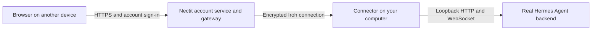

# Hermes Agent Universal Connector

Nectit connects to real Hermes Agent installations through Iroh, with an optional
Cloudflare transport. Start from the terminal, then open the local desktop-style
workspace. Your agent keeps running on your own computer.

## Open the Nectit web workspace

```sh
git clone https://github.com/itsflownium/hermes-agent-universal-connector.git
cd hermes-agent-universal-connector
./setup --desktop
./nectit app
```

Requires Node.js 22+, Python 3.10+ and an installed Hermes Desktop build. Three
setup pages handle email/password sign-up and sign-in, your workspace URL and the
computer connection. Completed sign-in opens the **actual installed Hermes
Desktop interface**: chat tabs, session history, model controls, capabilities and
settings. Nectit loads its current assets from your computer instead of copying
the UI. Update Hermes there and reload/reopen the workspace to use that build.

The preview starts signed out at `http://127.0.0.1:8788`. Create your account
with an email and password; return with the same credentials to sign in.
Nothing is deployed by these commands. Any-device browser access needs a reachable
HTTPS gateway; Iroh links that gateway to your laptop. See [app setup and gateway
configuration](app/README.md) for the complete flow, updates and current limits.

## Each installation is private and local

Cloning this repository starts with an empty Nectit account and no connected
computer. Create your own email/password account, then connect **your own**
Hermes installation. The code does not contain a preconfigured account, an
endpoint ticket, a native session cookie or model API keys. Someone else's clone
does not connect to the repository owner's computer.

`http://127.0.0.1:8788` points to the computer running the command. Browser chats
are handled by its connected Hermes backend, so the agent uses that computer's
existing models, tools and sessions. Another computer can connect over Iroh only
with a host's endpoint ticket and sharing credentials. Phone/browser-only access
from elsewhere still needs a reachable HTTPS gateway.

Runtime settings, password hashes, native cookies and Iroh keys remain in ignored
private state directories. Keep those files private when sharing a checkout.
The current local app supports one account per data directory; shared public
registration, personal subdomains, email verification and password recovery are
not enabled in this release.

## Terminal-only dashboard setup

On the computer that already has Hermes Agent installed and configured:

```sh
git clone https://github.com/itsflownium/hermes-agent-universal-connector.git
cd hermes-agent-universal-connector
./setup
```

Choose **Share Hermes on this computer**, enter an email address and a strong password,
and keep the printed endpoint ticket. Setup downloads the checksum-verified Iroh
transport into this checkout and starts a dedicated Hermes connection. It needs
Git and Python 3.10+; it does not install global packages or change your shell.

On the other computer, clone the same repository and run:

```sh
./setup --mode client
```

Paste the endpoint ticket, then sign in at the printed local URL with the host's
email and password. This client computer does not need Hermes installed.
Leave its command running to keep the connection open.

For an already deployed provider-account service, use
`./setup --mode account --server https://your-service-host` on the Hermes computer.
Setup opens device pairing and starts the connection after approval. Provider
sign-in requires the operator's configured service; private Iroh sharing works now.

Use `./setup --check` to inspect prerequisites without changes, or
`./setup --prepare-only` to prepare the transport before an interactive setup.
`./nectit off`, `./nectit on`, and `./nectit status` manage the saved connection.
Run `./setup --help` for an existing transport path, Hermes profile, workspace,
ports, state directory, or noninteractive password input.

## How the connection works

Hermes Agent continues running on your own computer, with its existing models,
tools, files and configuration. Nectit manages a dedicated dashboard process
and an encrypted Iroh connection. Your computer must stay awake and online.

There are two ways to reach it:

- **Direct access:** run `nectit share` on the Hermes computer, then
  `nectit access <ticket>` on the connecting computer. The access command
  opens a local browser URL that travels over Iroh to the real Hermes dashboard.
  Hermes checks the sharing email and password. This works without a domain
  or a hosted account service; the connecting device needs the access client.
- **Website access:** deploy the account service once, then pair the Hermes
  computer using `nectit login`. GitHub sign-in establishes account ownership.
  The computer advertises its Iroh endpoint to the service, whose gateway forwards
  browser requests to Hermes after checking the owner. Native Hermes signs in
  through the service's OIDC provider. A hosting provider's HTTPS address and a
  per-device path work without buying a domain; personal subdomains are optional.



`nectit on` starts the saved connection; `nectit off` closes the transport and
its managed Hermes dashboard. If authentication disappears, a managed child exits,
or the platform revokes the paired device, the controller disables remote access.
No agent runs on the account server, and model API keys stay with Hermes.

## Use it now: Iroh and a password

Requires Python 3.10+, an existing Hermes installation, and the official Iroh
`dumbpipe` executable. The host supports macOS, Linux, and Windows through WSL2.
Hermes's browser chat requires a POSIX PTY, so native Windows should run the host
inside WSL2. The Iroh transport itself has native Windows binaries.

Install the pinned, checksum-verified transport into the project directory:

```sh
python3 tools/install_iroh.py --directory work/bin
```

On the laptop with Hermes:

```sh
./nectit share --email you@example.com --dumbpipe-bin ./work/bin/dumbpipe
```

Enter a sharing password at the hidden prompt. Nectit starts a dedicated real
Hermes dashboard, verifies its password gate, and then enables Iroh. It prints
an endpoint ticket, not a secret key. The password is stored as a salted scrypt
hash; secrets are never command-line arguments.

On another computer with this connector and `dumbpipe` installed:

```sh
./nectit access <endpoint-ticket> --dumbpipe-bin ./work/bin/dumbpipe
```

Open the printed loopback browser URL and sign in with the host's credentials.
The connection between the computers uses Iroh's authenticated encryption and
NAT traversal/relay support. **A registered domain and Cloudflare are not needed.**
Leave the access command running; Ctrl+C disconnects that client.

On the host:

```sh
./nectit status
./nectit off
./nectit on
./nectit doctor
```

`off` disables the processes Nectit started. It does not power off the laptop
or terminate independently running Hermes sessions. `on` reuses the saved sharing
configuration. The laptop must remain awake and connected. A native Hermes chat
tab controls its own PTY lifetime; tasks are not promised to survive closing it.

The host also supports `local`, `login`, `open`, and `logout`. Use `--profile NAME`
to select an existing Hermes profile or `--hermes-bin PATH` for another install.
State defaults to `~/.config/flownium`; override with global `--state-dir PATH`.
The controller uses a private Unix control socket rather than trusting stored
PIDs. Do not enable other dashboard auth providers in a password-sharing profile.

For a packaged command, install this source with `python3 -m pip install .`.

## Server/account backend

```sh
node service/server.mjs
```

The service boots without GitHub or Cloudflare credentials. `/health` and
`/v1/capabilities` report the configuration state; unconfigured integrations
return explicit errors. Use Node 22+ and run one service process per data directory.

With a deployed account-service origin and a GitHub OAuth app configured:

```sh
./nectit login --server https://your-provider-supplied-host --transport iroh
./nectit on
```

The operator sets `SERVICE_URL` in `flownium_distribution.py` before distributing
the package, so ordinary users can simply run `nectit login`. Users do not
configure DNS or supply platform credentials.

The service provides device-code pairing, account ownership, OIDC authorization
code/PKCE authentication for native Hermes, signed ID tokens, rotating refresh
tokens, scoped endpoint heartbeats, device status and revocation. The host uses
the existing Hermes model, tools, skills and conversations. It does not emulate
the agent or copy API keys to the platform.

The Iroh gateway forwards HTTP, streaming responses and WebSocket upgrades to
registered laptops. With no custom domain it routes by
`<service-origin>/remote/<device-id>/...`. This can use a hosting provider's default
HTTPS address. A regular browser needs this gateway or a local Iroh access client;
an Iroh endpoint ticket is not itself an HTTPS URL.

Optional personal subdomains can be enabled under a platform-owned namespace.
Cloudflare-specific configuration is also optional; use `--transport cloudflare`
after the operator supplies the account/zone credentials. Platform Cloudflare
credentials remain on the server; only device-scoped tunnel tokens reach laptops.

See [the backend protocol](docs/backend.md) and
[operator environment example](service/operator.env.example).

## Verification

```sh
python3 -m unittest discover -s tests -p test_cli.py -v
node --test service/core.test.mjs service/iroh-gateway.test.mjs app/server.test.mjs
```

Opt-in checks against an installed real Hermes, with no model inference request:

```sh
python3 tests/live_hermes_check.py
node tests/live_oidc_check.mjs
python3 tests/live_iroh_check.py --dumbpipe-bin ./work/bin/dumbpipe
FLOWNIUM_IROH_BIN=./work/bin/dumbpipe node tests/live_gateway_check.mjs
```

The Iroh check uses two real endpoints and real Hermes password authentication;
it verifies rejected credentials and an authenticated chat page without a domain
or Cloudflare. The OIDC check uses real Hermes and the real local OIDC service,
with isolated fixtures only for external GitHub identity and Cloudflare.
CI runs host tests on Linux/macOS and service tests on Linux. Cross-region
connectivity and live Cloudflare/GitHub provisioning are not yet verified.

The account service currently uses a single-process JSON store and a persisted
RSA signing key. Multi-instance storage and signing-key rotation remain deployment
work before broad registration. The local app is the first interface; public
website deployment remains separate from this local build.

References: [Hermes dashboard](https://hermes-agent.nousresearch.com/docs/user-guide/features/web-dashboard),
[official Iroh dumbpipe](https://github.com/n0-computer/dumbpipe),
[Cloudflare Tunnel](https://developers.cloudflare.com/cloudflare-one/networks/connectors/cloudflare-tunnel/).
